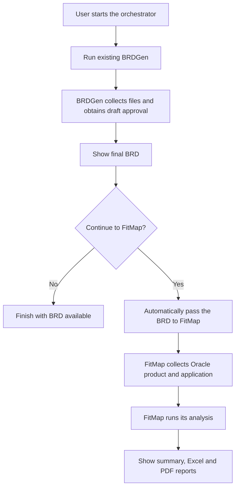

# Proposal: Conversational Orchestrator for BRDGen and FitMap

## Objective

Create a new Aetherion conversational agent that connects BRDGen and FitMap in one conversation. It automatically passes BRDGen's final document to FitMap after the user agrees to continue.

**Neither existing agent will be modified.** Their processing logic, input forms, and review steps will be reused.

## Proposed flow

All questions and results appear in the same conversation. The user does not need to download and re-upload the BRD.

## Architecture

The orchestrator contains three small components:

| Component | Responsibility |
|---|---|
| Conversation instructions | Explain the service and recognize when the user wants to start. |
| Workflow controller | Manage BRDGen -> user decision -> FitMap, and retain progress and results. |
| Platform connector | Invoke the existing agents through Aetherion, route their interactions to the conversation, and retrieve results. |

BRDGen continues to generate requirements. FitMap continues to perform analysis. The orchestrator only coordinates their execution.

## Implementation phases

| Phase | Work | Expected outcome |
|---|---|---|
| 1. Create the conversational agent | Create a separate project and register it using Aetherion's @agent and @register, with chat_enabled=True and hitl_enabled=True. Define conversation instructions and input/output schemas. | A conversational entry point for the combined process. |
| 2. Connect BRDGen | Invoke BRDGen with available inputs. Let its existing workflow handle missing uploads, validation, and draft approval. Capture its final result. | Users complete the existing BRD process through the orchestrator. |
| 3. Add the decision and handoff | Show the BRD and ask, "Would you like to continue with FitGap analysis?" On Yes, pass its saved document reference to FitMap. On No, finish with the BRD available. | Automatic transfer controlled by explicit user consent. |
| 4. Connect FitMap and deliver results | Let FitMap collect Oracle selections and execute its existing pipeline. Display its summary and Excel/PDF reports. | The complete process runs in one conversation. |
| 5. Add recovery, test, and publish | Handle cancellation, timeout, failures, and retries. Test the complete flow in the sandbox, then publish the new agent. | Reliable orchestration with both existing agents unchanged. |

## File handoff

The orchestrator takes the final requirements document's `file_key` from BRDGen's `outputs` and supplies it as FitMap's `brd_file`.

- Prefer **Excel**, which preserves requirement IDs and process columns.
- Support **Word** when selected by the user.
- Pass only the requirements document, not the accompanying masking ZIP.
- Reuse the stored file; do not regenerate, convert, or re-upload it.

FitMap's existing forms collect the Oracle product and application, so the orchestrator does not duplicate those questions.

## Edge cases and recovery

Save the current stage, run IDs, document reference, user decision, and results. Validate the following scenarios during testing:

| Edge case | Planned handling |
|---|---|
| BRDGen fails or review is cancelled | Stop; do not start FitMap. |
| BRDGen returns a partial result | Show its warning before requesting consent to continue. |
| User selects No or does not respond within 24 hours | Finish with the BRD available. |
| Repeated Yes or execution restart | Use saved run IDs and unique request keys to prevent duplicate runs. |
| Multiple outputs or missing/inaccessible file | Select only the BRD document, never the ZIP; stop if its reference is unusable. |
| FitMap fails | Retain the BRD and allow an explicit FitMap-only retry. |
| Reply to an old or incorrect question | Match replies to the active run and question before proceeding. |

## Acceptance criteria

- One conversation throughout, including existing input and review forms.
- No manual file transfer between agents.
- FitMap starts only after explicit user agreement.
- BRD and final reports remain accessible.
- Retries do not unnecessarily repeat completed work.
- No changes to either existing agent and no duplication of their processing logic.
